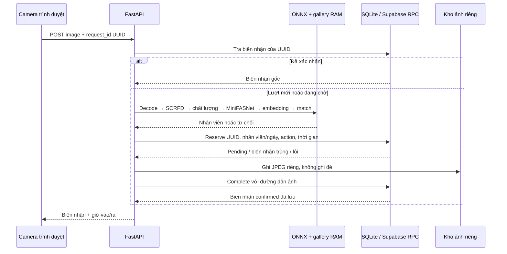

# Kiến trúc bản tối ưu

Luồng phục vụ: `backend.main` → `runtime.app` → `AttendanceApplication`. Không import dlib/DeepFace/PyTorch khi chạy engine mặc định.

## Model và quyết định nhận diện

SCRFD-500MF ở 320×320, letterbox; 5 landmark căn chỉnh về 112×112; MobileFaceNet xuất vector 512 chiều chuẩn hóa. Hai MiniFASNet dùng vùng có ngữ cảnh ×2.7/×4, BGR 0–255, NHWC; softmax đã có trong ONNX. Không đưa crop đã align cho PAD vì làm mất ngữ cảnh màn hình/ảnh in.

Mỗi ảnh được giải mã/phát hiện một lần. Từ chối nhiều người, mặt quá nhỏ/mờ/tối/quá sáng trước khi match. Chất lượng `face-quality-v2` đo trên ROI chuẩn hóa 128×128; ngưỡng do server cung cấp cho camera worker. Crop chỉ dùng để đo chất lượng, không thay ảnh gốc đưa vào PAD/recognizer. Liveness mặc định 0.85; cosine 0.50 và khoảng cách với **người thứ hai** 0.08. Nhiều template của cùng một người không bị coi là ứng viên cạnh tranh. Các ngưỡng là cấu hình ban đầu, cần hiệu chỉnh trên camera thật; không phải ngưỡng bảo đảm sai số.

Đăng ký camera có preflight admin + consent cho từng ảnh được chọn; kiểm tra chất lượng và so embedding với ảnh thẳng tham chiếu trong cùng request. Không ghi profile/ảnh/lượt công hoặc trả vector về client. Một preflight mỗi process, dùng chung khóa inference, trả 429 khi bận. Cuối luồng vẫn kiểm tra cả bộ và ghi nguyên tử. Xem [AUTO_ENROLLMENT.md](AUTO_ENROLLMENT.md) về giới hạn retry và việc nhãn pose không thay cho liveness.

Không ghép OR nhiều engine. `face_model` gồm tên pack và SHA-256 của recognizer; gallery chỉ dùng template thuộc model đó. Hồ sơ dlib 128 chiều được giữ riêng trong `face_profiles`. Đổi detector/căn chỉnh/ngưỡng vẫn cần nghiệm thu lại dù recognizer giữ nguyên.

ONNX sessions nạp một lần, CPU mặc định 1 luồng/session, OpenCL và busy spinning tắt. Có khóa inference với chờ tối đa 50 ms, quá tải trả 429 để trạm backoff; không tích lũy vô hạn ảnh cũ. Mặc định một worker; nhiều worker sẽ nhân RAM/model và cần đo lại.

## Gallery và I/O

Gallery ma trận float32 bất biến, thay tham chiếu sau khi refresh hoàn tất. Nhận diện không tải lại vector. Màn danh sách dùng metadata cache + attendance, không truy vấn vector mỗi lần. Đăng ký/cập nhật refresh ngay; tác vụ nền refresh mỗi 30 giây; quá 120 giây chưa đồng bộ thành công thì từ chối nhận diện/list/readiness. Sau khi sửa trực tiếp DB phải chờ refresh hoặc khởi động lại; sau xóa/quyền khẩn cấp nên khởi động lại để hết cache ngay.

SQLite dùng WAL, foreign keys và `BEGIN IMMEDIATE` cho ghi. Giao dịch ngắn, không giữ khóa DB trong lúc ONNX hoặc lưu ảnh. Supabase dùng một HTTPX Client pooling; reserve/complete là RPC với khóa giao dịch theo UUID và nhân viên/ngày. Không retry ghi tự động ở transport.

## Nhất quán và khôi phục lỗi

UUID tồn tại xuyên retry/reload của tab; biên nhận confirmed bất biến. Máy chủ chọn giờ và loại vào/ra khi reserve lần đầu. Ảnh lưu theo `ngày/employee_id/in|out/uuid.jpg`; local fsync + tạo file nguyên tử, remote không upsert. Sau ảnh mới commit công và biên nhận. Supabase RPC kiểm tra object tương ứng trong `storage.objects`.

Ảnh và DB không có giao dịch phân tán chung: nếu chết sau khi ghi ảnh có thể còn ảnh mồ côi/pending, nhưng không báo thành công trước commit. Retry cùng UUID giữ ảnh đầu và hoàn tất. Pending quá 120 giây được abandon khi truy vấn lại hoặc có lượt mới; UUID cũ không được dùng lại. Giữ ảnh mồ côi để kiểm tra trước khi dọn, không tự xóa dữ liệu.

Hai ý định khác nhau cùng lúc được điều phối; mặc định auto trong 30 giây sau giờ vào trả lại giờ vào. Explicit `out` không áp dụng cooldown; endpoint dành cho tích hợp có chủ đích. Muốn nhiều ca/ca qua đêm cần mở rộng mô hình nghiệp vụ, không chỉ chỉnh cooldown.

## Bảo vệ dữ liệu

Production bắt buộc admin key ≥32 ký tự; kiosk key khác admin và không được đăng ký/cập nhật mặt. Mỗi API nghiệp vụ kiểm tra bearer; consent kiểm tra phía server. SQLite/ảnh không được phục vụ như static files. Supabase chỉ server giữ secret, bảng/RPC khóa quyền anon/authenticated, bucket riêng tư.

CORS là danh sách origin rõ ràng; không thay thế xác thực. UI giữ key ở sessionStorage, nhập riêng khi chạy; không có secret trong Vite bundle. Backend chỉ log tên route, trạng thái và thời gian; không log ảnh/vector/mã truy cập. Hạn chế tiếp cận máy trạm, dùng HTTPS và phân quyền thư mục dữ liệu khi vận hành.
